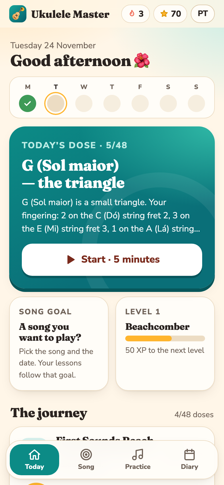
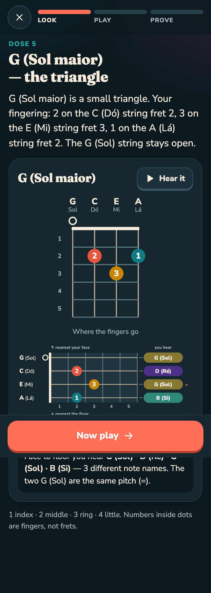

# Ukulele Master

Learn ukulele in small daily doses, in English and Portuguese. One idea, one picture, one exercise, and a microphone check that confirms what you played.

**Play it:** <https://educrvz.github.io/ukulele-master/> — works in any modern browser, installs on a phone like an app, and runs offline.

<p>
  
  
</p>

## What is in it

| Screen | What it does |
| --- | --- |
| **Today** | Today's five-minute dose, this week's practice days, your song goal and level, and the journey: 48 doses on 8 islands, then a generated daily challenge. One new dose per day; replays are free. |
| **Lesson** | Full-screen, three steps: **Look** (one idea with the chord diagram), **Play** (numbered steps, play-along sound, metronome, four-minute timer; the screen stays awake), **Prove** (microphone check, or an honest self-report). |
| **Song** | Pick a song and a date. The app turns it into tiny lessons and replans after every check-in. Four starter songs are built in; other songs need a chord analysis pasted from an AI assistant. |
| **Practice** | Tuner, metronome, the one-minute chord-change game, and the full chord library. |
| **Diary** | Streak, calendar, recordings, practice log, progress report for Notion, backup export/import, light/dark appearance, install. |

Every note and chord is shown as letter + Portuguese name, for example `G (Sol maior)`. Every chord has two views: where the fingers go, and the note each string sounds.

## Install on a phone

1. Open <https://educrvz.github.io/ukulele-master/> on the phone.
2. **iPhone / iPad (Safari):** Share → *Add to Home Screen*.
   **Android (Chrome):** tap *Install* on the home banner, or menu → *Install app*.
3. Open it from the home screen. It runs full-screen and works without internet.

Progress and recordings are stored in that browser on that device only. To move devices, use Diary → *Export backup*, then *Import backup* on the other one.

## Run locally

No build step and no dependencies for the app itself.

```bash
python3 -m http.server 8765 --bind 127.0.0.1
```

Then open <http://127.0.0.1:8765/>. Add `?date=YYYY-MM-DD` to pretend it is another day.

## Test

Needs Python Playwright with Chromium (headless). With the local server running:

```bash
python3 tests/smoke.py
```

```bash
python3 tests/shots.py /tmp/uke-shots
```

`smoke.py` runs 26 end-to-end checks (onboarding, all 48 doses in both languages, a full lesson, the chord-change game, song goal, dark mode, offline). `shots.py` saves screenshots of every screen for phone, desktop and dark mode.

## Folder layout

```text
index.html             page shell: top bar, tab bar, script tags
manifest.webmanifest   install metadata (name, icons, shortcuts)
sw.js                  service worker: offline cache, network-first updates
css/style.css          design system: tokens, light + dark themes, all components
js/
  data.js              chords and the 48-dose curriculum (bilingual text)
  diagrams.js          SVG chord chart, player's-view neck, strum patterns
  dsp.js               pitch / chroma / onset maths (pure functions)
  audio.js             synthesised demo sound and the play-along scheduler
  mic.js               microphone checks and recordings (IndexedDB)
  ui.js                icons, toast, confetti, haptics, wake lock, theme
  pwa.js               service-worker registration and install prompt
  song-catalog.js      starter songs (chords only, with source links)
  song-goal.js         Song Goal Mode: plan, lessons, check-ins
  app.js               views, navigation, progress (localStorage `uke-master-v1`)
icons/                 app icons (SVG source + generated PNGs)
tools/make-icons.py    regenerates the PNG icons from icons/icon.svg
tests/                 smoke test and screenshot script
docs/                  CONTEXT.md, RUNBOOK.md, decisions/, screenshots/
AGENTS.md              rules for AI coding agents (CLAUDE.md / GEMINI.md point here)
PROGRESS.md            shared change log between models, newest first
```

## Documentation

- [docs/CONTEXT.md](docs/CONTEXT.md) — who it is for, how it is built, data model.
- [docs/RUNBOOK.md](docs/RUNBOOK.md) — run, test, deploy, roll back.
- [docs/decisions/](docs/decisions/) — lasting choices and why.
- [PROGRESS.md](PROGRESS.md) — what changed, when, and what is still unverified.
- Learner's home page and class log: Notion, *Ukulele — lessons, visuals & progress*.

## Honest limits

- Microphone checks have not yet been calibrated with a real ukulele and a real phone microphone.
- Demonstration sound is synthesised, not a recording.
- Arbitrary songs are not looked up automatically; that would need a paid, capped backend.
