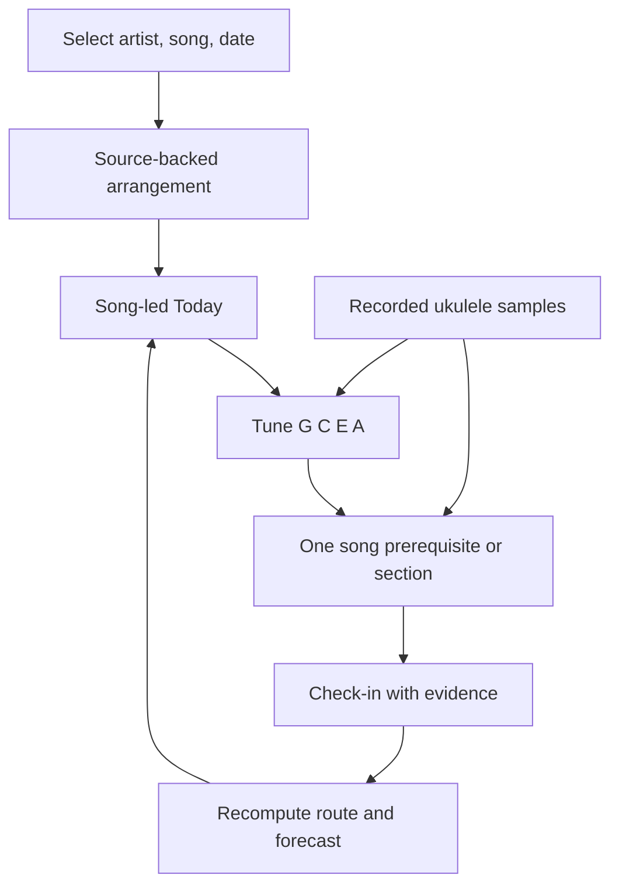

# Song-first lessons with natural ukulele sound

## Summary

Make the selected artist, song, and target date the app's primary path. Every practice session starts with tuning, then teaches one small prerequisite for that song and recalculates the remaining route after check-in. Replace the default synthesized instrument demos with licensed recordings of a real ukulele, subject to a listening check. Keep the existing visual design and preserve saved history.

---

## Problem Frame

Today currently advances through a fixed 48-dose course while the selected song lives in a separate tab. Tuning is a one-time goal step, so later classes do not begin with it. The instrument demos use oscillators and sound synthetic. This plan changes the learning route and playback source without treating delivered lessons as proof of practice; the [Notion learning home](https://app.notion.com/p/417eeae1044a8102acf7dc2bdce60a7a) records November 19 as the latest confirmed self-report, although later lessons were offered.

---

## Assumptions to Confirm Before Implementation

- “Reset” means replacing the primary learning flow, not silently deleting local progress or recordings. An existing learner is offered a non-destructive choice to start a new song journey or resume the current goal. A destructive erase requires a separate explicit choice and backup path.
- The learner selects a specific artist–song result in one search interaction, then a target date and daily time. A separate artist picker is unnecessary if the result clearly identifies both.
- Tuning opens every session even when the learner already knows how to tune. Microphone verification is optional; guided manual completion is always available and labeled self-reported.
- “Play the song by the date” means a complete beginner chord accompaniment through the source-backed section order at an honest practice tempo, with a steady simplified strum. It does not promise the recording's melody or studio arrangement.
- Free, recorded ukulele samples should be tried before any paid audio generation. The user's “file account” may mean fal; this does not need resolving if the free option meets the sound goal.

---

## Requirements

- R1. On first use or when starting a new goal, select an artist and song, then a target date; the learner never pastes chords or model output.
- R2. Today leads into the active song plan from the beginning. Foundational skills are taught in small steps, followed by song chords, changes, rhythm, sections, and a complete beginner accompaniment through the source-backed section order.
- R3. Every class begins with a G–C–E–A tuning checkpoint before its song exercise, regardless of prior tuning mastery.
- R4. After each check-in, recompute the next exercise, remaining work, date forecast, and missed-day recovery from recorded evidence. Opening or offering a lesson never auto-completes it; an explicit self-report is accepted but labeled as such.
- R5. The default instrument sound is recognizably more natural, pitch-correct, responsive on a phone, and available offline. Do not introduce a paid per-play audio dependency.
- R6. Preserve the existing bilingual interface, current appearance, source-linked chord-only arrangements, learner-specific G fingering, access protection, and browser-local history.

The earlier [Song Goal PRD](https://app.notion.com/p/420eeae1044a81659248ff23c004e80c) supplies the source/arrangement and backward-planning constraints. This request supersedes its optional-song/fixed-course coexistence: song selection is now the main entrance, and tuning recurs every class.

---

## Scope Boundaries

- No app code, asset download, test run, live deployment, or progress erase occurs in this planning pass.
- Do not invent chords when no trustworthy source is available. Keep the song-analysis retry and let the learner change the song; goal-neutral tuning, holding, open-string, and pulse lessons remain available while analysis is pending, clearly labeled as foundations.
- Do not add audio-to-chord transcription, streaming commercial recordings, lyrics, a second simultaneous goal, or a new account/sync system.
- Keep the fixed 48-dose material as reusable teaching content and historical record; it no longer drives the main Today route. Preserve access to old history in Diary.

### Deferred to Follow-Up Work

- A full cross-device sync with Notion or a user database remains separate work.
- ElevenLabs or fal narration, ambience, or generated backing tracks remain optional follow-ups if real sampled playback meets the core need.

---

## Context & Research

### Relevant Code and Patterns

- `js/app.js` owns onboarding, Today, the fixed-dose route, local state, and the existing tuner. `js/data.js` contains the foundational teaching material and paired English/Portuguese text.
- `js/song-goal.js` already handles song selection, sourced arrangements, plan estimates, check-ins, and a one-time tuning step. `api/search.js`, `api/song.js`, and `lib/chord-source.js` provide the private lookup path.
- `js/mic.js` has a stable-pitch four-string tuning check and distinguishes microphone evidence from self-report. `js/audio.js` has a scheduler worth preserving; its `Snd.pluck` oscillator timbre is the replacement seam.
- `js/app.js` persists `uke-master-v1` in localStorage; `js/mic.js` stores recordings in IndexedDB. The current backup and `js/migrate.js` old-origin transfer carry localStorage, not recording audio. `sw.js` lists offline shell assets and currently handles dynamic GET requests too, so search caching needs scrutiny.

### External References

- [FreePats Ukulele](https://freepats.zenvoid.org/GuitarFamily/ukulele.html) is a CC0 recording of a real tenor ukulele, sampled C4–C6 with a chuck and body tap. Its WAV bank is about 2.8 MiB; [the source repository](https://github.com/freepats/ukulele1) documents 13 pitched samples and the license. It is the first candidate, not an accepted audio asset yet.
- [Web Audio sample playback](https://developer.mozilla.org/en-US/docs/Web/API/AudioBufferSourceNode/start) can schedule decoded recorded notes on the app's existing clock. Pitch shifting changes playback speed and timbre, so the implementation should use the nearest appropriate recording and limit shifting.
- [ElevenLabs Music](https://elevenlabs.io/docs/overview/capabilities/music) generates composed audio. It and [fal audio models](https://fal.ai/explore/audio-models) are less suitable for exact note and strum cues with low latency; that suitability judgment is an inference from their generation workflows, not a vendor prohibition.

---

## Key Technical Decisions

| Decision | Rationale |
| --- | --- |
| One song-led Today path, with the old dose sequence outside the main route | The learner always sees why today's skill leads to the selected song; no competing curriculum advances by accident. |
| Treat tuning as a session opener, separate from song mastery | A completed tuning skill cannot suppress tomorrow's tuning. Evidence for tuning and evidence for the exercise remain distinct. |
| Replan locally and deterministically after each check-in | The route can respond immediately and offline without billing a model for every practice report; AI/source lookup is reserved for song analysis. A beginner arrangement keeps verified chords and section order, while slowing tempo and simplifying the strum; it does not invent substitute harmony. |
| Use recorded samples behind the existing audio scheduler | Improves timbre without changing tempo and play-along timing or introducing a per-play service call. |
| Preserve old saved state through an explicit migration | `uke-master-v1` holds real practice history; replacing or clearing it silently would lose evidence and recordings would remain separately in IndexedDB. |

---

## High-Level Technical Design

*This illustrates the intended approach and is directional guidance for review, not implementation specification. The implementing agent should treat it as context, not code to reproduce.*

The tuning display may use reference notes, but microphone pitch judgment must continue to listen to the learner's instrument rather than its own playback.

---

## Implementation Units

- U1. **Make song selection the main entrance**

**Goal:** A new learner reaches artist–song selection and a deadline before any fixed course begins; a returning learner reaches the active song.

**Requirements:** R1, R2, R6

**Dependencies:** None

**Files:** Modify `js/app.js`, `js/song-goal.js`, `css/style.css`, `sw.js`; modify `js/migrate.js` only if the old-origin transfer needs an adjustment; test `tests/smoke.py`, `tests/migrate.test.js`.

**Approach:** Reuse the existing suggestion/result and source-analysis flow. Make Today display setup, analysis progress, or the active song session according to goal state. Offer existing learners a visible start-new-versus-resume choice; archive the previous goal and its evidence within the local app state before replacement. Keep the existing visual language and fixed-dose history; migrate the state shape without clearing it. Same-origin IndexedDB recordings remain untouched; backup and old-origin transfer continue to carry only localStorage data. Bound archived history and check transfer size so a large URL fragment does not break migration; clear received fragments promptly and warn against sharing transfer links. Exclude dynamic song-search responses from an unsafe pathname-only offline cache, while keeping starter songs available offline.

**Patterns to follow:** Delegated view/actions and bilingual labels in `js/app.js`; song search and source validation in `js/song-goal.js`; local migration in `js/migrate.js`.

**Test scenarios:**
- Fresh browser: language choice leads to artist–song search and date; no fixed dose starts first.
- Returning browser with an existing goal: Today shows that goal without asking for setup again.
- Old `uke-master-v1` state with dose and song history: migration preserves logs, evidence labels, and the active goal; same-origin IndexedDB recordings remain available, while old-origin recordings remain on that old address.
- Returning learner chooses “start again”: a new goal setup opens and the old goal remains readable; “resume” retains the active goal.
- Search unavailable or analysis fails: show retry/change-song state, not a fabricated song lesson; offer goal-neutral foundations.
- Offline search for different queries never displays stale suggestions from another query; built-in starter songs remain selectable.
- A large archived history does not silently truncate or overwrite the old-origin transfer, and a shared transfer link is documented as containing practice data.
- Selecting a different song: old goal history remains accessible and the new song begins at its own foundation.

**Verification:** The main route has one active song goal and no silent progress loss.

- U2. **Start every session with tuning**

**Goal:** Tuning is the first interaction in every class, then the session advances to one song exercise.

**Requirements:** R2, R3, R4, R6

**Dependencies:** U1

**Files:** Modify `js/app.js`, `js/song-goal.js`, `js/mic.js` only if needed; test `tests/smoke.py`, `tests/listening.test.js` only if microphone code changes.

**Approach:** Make tuning a per-session checkpoint rather than a one-time item in `songSteps`. Reuse the G–C–E–A tuner and the existing evidence distinction. Offer guided/manual completion every time, label it self-reported, and never claim the instrument was verified from silence. Pause reference-note playback while the microphone listens so the app cannot count itself. Keep the short song exercise separate so tuning can take the time it needs.

**Patterns to follow:** `TuneCheck` and evidence labels in `js/mic.js`; learner's high-G tuning and G 2–3–1 fingering in `js/data.js` and `AGENTS.md`.

**Test scenarios:**
- First, next-day, and already-skilled sessions each show tuning before the song exercise.
- Accurate four-string microphone input records verified tuning; silence, room noise, or a wrong pitch does not.
- Denied microphone, offline use, or an already-tuned instrument allows guided self-report and labels it correctly.
- Reference-note playback cannot satisfy the microphone's four-string check.
- Leaving during tuning and returning resumes the session without awarding song mastery.
- Opening an exercise alone grants no mastery; an explicit self-report or successful microphone check is required, and the evidence label is accurate.

**Verification:** Every class begins at the tuning checkpoint and the evidence label matches what happened.

- U3. **Shape the song-specific route and replan**

**Goal:** Work from absolute beginner skills to a playable arrangement by the chosen date, adapting after every reported session.

**Requirements:** R2, R4, R6

**Dependencies:** U1, U2

**Files:** Modify `js/song-goal.js`, `api/song.js`, `lib/chord-source.js`; modify `js/data.js` only for reused foundation content; test `tests/smoke.py`, `tests/song-api.test.js`.

**Approach:** Reuse sourced chord-only sections and the current backward-planning buffer. Place posture/open-string/rhythm foundations before unfamiliar song chords, then changes, sections, and full beginner accompaniment. Change the source parser to preserve whether its section/chord limits truncated the chart and carry coverage metadata to the plan. Default to “practice excerpt” whenever complete coverage cannot be established; only a verified complete sequence can support a whole-song promise. Represent performance levels as changes in practice tempo, strum complexity, and fluency while retaining the source-backed chord and section sequence; label the full recorded arrangement as outside this plan unless independently verified. Recalculate next skill, workload, current performance level, and deadline forecast from the selected song, available minutes, mastery evidence, and the current date. A hard check-in repeats a smaller exercise or slower tempo; a comfortable one advances; a missed day redistributes work. Present an honest shorter-date forecast.

**Patterns to follow:** `songSteps`/`plan` and goal history in `js/song-goal.js`; source-linked arrangements in `lib/chord-source.js`; no lyrics or invented chords.

**Test scenarios:**
- Beginner selects “Three Little Birds” with a workable date: foundation, its chords, changes, sections, and full play-through appear in order.
- Hard/okay/easy check-ins on the same step produce appropriate repeat at slower tempo, partial advancement, and advancement, and each recomputes the forecast without changing verified chords.
- Missing one or more days changes the remaining schedule without recording a session.
- Tomorrow's visit starts with tuning even when yesterday's song step is mastered.
- A date too close or already passed yields an honest smaller goal or date adjustment, with no negative schedule.
- Unsupported or unsourced chords never become a supposedly verified lesson.
- A chart with only a fragment of the song is labeled as an excerpt and does not promise a full-song play-through.
- Source parsing that reaches a section/chord limit reports truncation; unknown coverage defaults to excerpt status rather than a complete-song claim.

**Verification:** A learner can trace today's exercise to the song, and the plan responds to evidence and time rather than only page visits.

- U4. **Replace the default instrument timbre with recorded ukulele**

**Goal:** Notes, chords, and play-along sound like a real ukulele while keeping accurate pitch, timing, and offline use.

**Requirements:** R5, R6

**Dependencies:** None; integrate after U2 and U3

**Files:** Create `assets/audio/ukulele/` with only selected licensed assets and provenance; modify `js/audio.js`, `sw.js`, `docs/CONTEXT.md`; test `tests/audio.test.js`, `tests/smoke.py`.

**Approach:** First audition the FreePats bank against the current oscillator for isolated notes, four-string tuning references, slow chords, down/up strums, and a song exercise on a phone. If the 13-note bank still sounds mechanical, prefer another suitably licensed sample bank; recording Edu's instrument is an option only after he approves capture and use. Before any first-party audio enters the public repo, review it for incidental speech and metadata. Preload and decode the needed samples before enabling the first play action; use Web Audio buffers with nearest-note mapping, modest pitch shifts, velocity variation, and the current scheduler. Keep one consistent sound source within a session. The existing synthesizer is an explicitly indicated fallback only when samples fail to load. Do not add an ElevenLabs/fal key for per-note playback.

**Patterns to follow:** `Snd`/`Player` timing seam in `js/audio.js`; precache list in `sw.js`; public-repo asset provenance and license documentation.

**Test scenarios:**
- Each reference string and supported chord note plays at the expected pitch and stops cleanly; repeated notes and simultaneous chords do not leak audio nodes.
- Slow/fast and up/down patterns preserve timing and audible direction; chuck remains distinct.
- First online load, later offline load, and a cached upgrade all play the recorded sound.
- First play waits for decode readiness and does not start silent or switch from sampled to synthetic notes mid-session.
- Decode failure or unsupported format surfaces a clear fallback and the lesson remains usable.
- A blind or side-by-side listening check with Edu prefers the new instrument sound over the existing synthesizer before release.

**Verification:** The selected bank has a recorded license/provenance, passes pitch and offline checks, and Edu accepts the sound comparison.

- U5. **Integrate, document, and release the new path**

**Goal:** Ship one coherent learner experience without losing history or weakening access controls.

**Requirements:** R1–R6

**Dependencies:** U1–U4

**Files:** Modify `README.md`, `AGENTS.md`, `docs/CONTEXT.md`, `docs/RUNBOOK.md`, `PROGRESS.md`; add an architecture decision in `docs/decisions/` if the audio asset or state migration creates a lasting new rule; test `tests/smoke.py`, `tests/audio.test.js`, `tests/migrate.test.js`.

**Approach:** Review the bilingual 390px flow, dark mode, keyboard/touch targets, service-worker update, protected production and preview URLs, old-origin transfer, and Notion app guide. Keep old progress until the user explicitly chooses any erase. Document selected audio provenance and the unchanged server-only AI credential boundary.

**Test scenarios:**
- Complete first session and next-day session in English and Portuguese at phone width; both start with tuning and play the goal's arrangement.
- Install, reload, go offline, and return online without losing active song/history or sampled audio.
- Existing browser backup and old-origin transfer retain localStorage evidence and recording references only. Same-origin recording audio survives in place; old-origin audio remains on the old address. No secret or personal recording appears in the public repository.
- An unauthenticated request to the app, assets, and API still requires Vercel sign-in.

**Verification:** End-to-end app checks and a real-phone listening/tuning review pass; the Notion guide and shared repo log describe the shipped behavior.

---

## System-Wide Impact

- **Interaction graph:** Onboarding and Today route into the goal state; each session passes through tuner, song exercise, evidence capture, and replanning. Audio is shared by lesson previews, play-along, and tuning references.
- **Error propagation:** Song-source failures leave the goal in a recoverable analysis state; sample failures show a fallback. Neither fabricates skill evidence.
- **State lifecycle:** Old dose history, goal history, and IndexedDB recordings must survive the new route. A new song must not overwrite the old goal without an accessible record or backup.
- **API surface:** Search and chord analysis stay server-side. No model call is needed at every check-in.
- **Integration coverage:** Source selection → lesson plan → repeated tuning → check-in → revised plan → offline return must be exercised together.

---

## Risks & Dependencies

| Risk | Mitigation |
| --- | --- |
| Recorded single notes still sound artificial as a strum | Make listening approval a gate; supplement with first-party real strums if needed. |
| Sample pitch shifting or processing changes the reference pitch | Verify decoded samples and rendered tuning notes against known pitches before release. |
| Every-session tuning feels like a blocking chore | Keep it short and guided; allow clearly labeled manual completion if the microphone is unavailable. |
| Source lookup cannot verify a chosen song | Keep retry/change-song path and avoid a false song-specific lesson. |
| A route change appears to erase old practice | Characterize current storage first; offer start-new/resume, archive prior goals, and migrate without renaming `uke-master-v1` or deleting same-origin IndexedDB recordings. Backups and old-origin transfer do not include recording audio. |
| Dynamic search response is reused for another query offline | Keep `/api/search` out of pathname-only service-worker caching or key it by query; test distinct searches across an offline transition. |
| Archived progress makes transfer links large or shareable | Bound transfer size, preserve the old copy on failure, remove received fragments, and clearly label such links as containing practice history. |
| Personal audio is published accidentally | Prefer CC0 assets; seek Edu's explicit approval and inspect speech/metadata before any first-party sample is committed. |
| Offline sample bundle makes first install slow | Start with the small CC0 bank, inspect transfer/cache size, and only ship assets used by the instrument. |

---

## Open Questions

### Resolved for this plan

- **Should playback call a paid model on each note?** No. A local recorded bank gives deterministic timing and offline availability; ElevenLabs/fal can be reconsidered for optional non-critical clips.
- **Should the model run after each check-in?** No. Reanalysis means recalculating from the latest evidence and deadline, not spending tokens to regenerate every session.

### To confirm before implementation

- Does “start again” include erasing existing local history, or only restarting the active lesson route? This plan preserves history until Edu explicitly chooses otherwise.
- Does Edu want an artist-first chooser, or is a combined song/artist search with a clearly identified result sufficient? The plan uses the existing combined search pending that preference.
- If the FreePats audition is not natural enough, would Edu prefer recording his own ukulele or choosing another licensed sample bank?

### Deferred to implementation

- Exact asset encoding and mapping depend on a phone audition and pitch/latency measurements.
- Exact foundation-step granularity depends on checking the existing dose material against the selected song's first chord set.

---

## Sources & References

- Product origin: [Song Goal PRD](https://app.notion.com/p/420eeae1044a81659248ff23c004e80c) and [Notion learning home](https://app.notion.com/p/417eeae1044a8102acf7dc2bdce60a7a).
- Existing architecture: `docs/CONTEXT.md`, `docs/RUNBOOK.md`, `js/app.js`, `js/song-goal.js`, `js/audio.js`, `js/mic.js`.
- Audio source and license: [FreePats Ukulele](https://freepats.zenvoid.org/GuitarFamily/ukulele.html), [FreePats source](https://github.com/freepats/ukulele1), [Web Audio sample playback](https://developer.mozilla.org/en-US/docs/Web/API/AudioBufferSourceNode/start).
